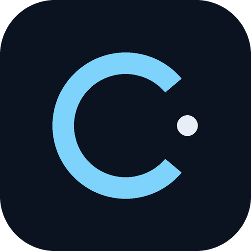
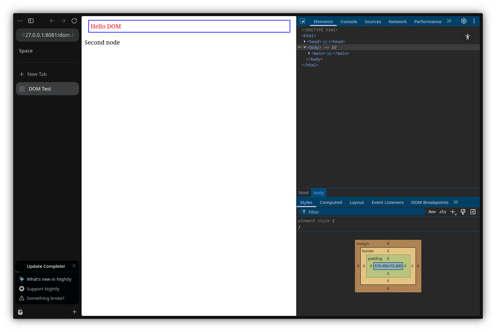

<div align="center">
  
  <h1>Chill Browser</h1>
  <p><strong>A calmer browser, with Chrome DevTools inside.</strong></p>
  <p>
    <a href="https://github.com/chill-browser/desktop/releases/latest">Download</a>
    ·
    <a href="https://github.com/chill-browser/www">Website</a>
    ·
    <a href="https://zen-browser.app">Built on Zen</a>
  </p>
</div>



Chill Browser is built on Zen 1.23.4b. It keeps vertical tabs, workspaces, split view and compact mode, and adds the full Chrome DevTools frontend docked into the browser window.

## Download

- **Linux x86_64** — available now, with the DevTools frontend and launcher included.
- **macOS** — native build required; not in the current release.
- **Windows** — native/cross build required; not in the current release.

The website selects the right asset from the latest release: [chill-browser/www](https://github.com/chill-browser/www).

## Build

```bash
npm ci
npm run download
npm run import
npm run build
npm run package
```

The browser is based on Zen and Firefox. The Chrome DevTools frontend is served locally by `scripts/serve_chrome_devtools.mjs`.

## License

MPL-2.0. Based on Zen Browser and the Chrome DevTools frontend.
