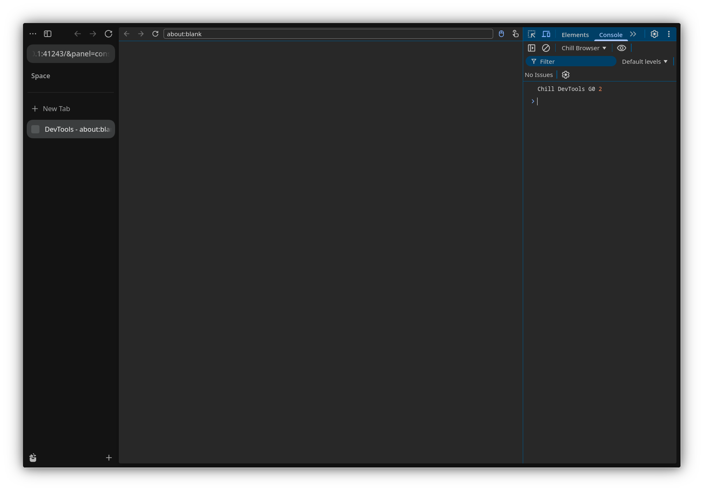

# G0 — Chrome DevTools bridge spike

## Resultado

O frontend oficial do Chrome DevTools carregou dentro do Zen, conectou no
WebSocket local e exibiu no painel Console o resultado de uma avaliação real
no target:

```text
Chill DevTools G0 2
```

O `2` veio de `1 + 1` avaliado no `about:blank` via `commands.scriptCommand`.



## Arquitetura validada

```text
Zen / aba selecionada
  -> ChromeDevToolsBridge (módulo privilegiado no processo pai)
     -> LocalTabCommandsFactory / commands / fronts
     -> adaptador CDP
     -> WebSocket local em 127.0.0.1
  -> frontend oficial do Chrome DevTools em hosted mode
```

- Sem processo Node em runtime.
- Sem Chromium.
- Sem `--start-debugger-server`.
- O frontend foi servido por um HTTP local temporário.
- O WebSocket reutiliza `devtools/server/socket/websocket-server.js`.

## Versões fixadas

- Firefox: `158.0.1`
- Chrome DevTools frontend: revisão
  `7da823b1d594d1b49797911900e003ec96a8c0e7`
- URL base do frontend:
  `https://chrome-devtools-frontend.appspot.com/serve_rev/@7da823b1d594d1b49797911900e003ec96a8c0e7/`

## Arquivos adicionados/alterados

- `src/zen/common/modules/ChromeDevToolsBridge.mjs`
  - bridge CDP mínima, servidor WebSocket e adaptação de `Runtime`, `Page`,
    `Log` e `Target`.
- `src/zen/common/modules/ZenStartup.mjs`
  - inicia a bridge depois do delayed startup, quando a pref está ligada.
- `src/zen/common/moz.build`
  - publica o módulo em `resource:///modules/zen/`.
- `scripts/fetch_chrome_devtools_frontend.py`
  - baixa e monta o frontend compilado em `.cache/chrome-devtools-frontend/`.
- `scripts/serve_chrome_devtools.mjs`
  - servidor HTTP local mínimo para o frontend.
- `docs/assets/g0-console.png`
  - evidência visual do Console.

## Como reproduzir

Na raiz de `desktop`:

```sh
python3 scripts/fetch_chrome_devtools_frontend.py
node scripts/serve_chrome_devtools.mjs
npm run build:ui
```

Em outro terminal:

```sh
cd engine
python3 ./mach run --temp-profile \
  --setpref chill.devtools.chrome.enabled=true \
  --setpref chill.devtools.chrome.spike-evaluate=true
```

A bridge abre uma aba com o frontend e imprime no terminal algo como:

```text
ChromeDevToolsBridge: WebSocket listening on ws://127.0.0.1:<port>/
ChromeDevToolsBridge: client connected
```

## Limitações conhecidas

- O target do G0 é a aba selecionada no momento do startup; trocar de aba
  depois disso não atualiza o target.
- Vários domínios ainda retornam erro explícito (`DOM`, `CSS`, `Debugger`,
  `Overlay`, `Network`, etc.).
- O servidor HTTP do frontend é separado e ainda não tem token/Origin.
- O frontend é baixado para `.cache/`; ainda não está vendorizado no Git.
- O modo docked ainda não existe; o frontend abre em uma aba.
- A avaliação do G0 é disparada pela pref `chill.devtools.chrome.spike-evaluate`.

## Próximo gate — G1

- Remover o spike e implementar `Runtime.evaluate` a partir do input real do
  Console.
- Mapear objetos, exceções, `Runtime.getProperties` e contextos de execução.
- Encaminhar `consoleAPICall` e `pageError` de forma estável.
- Adicionar teste de protocolo com cliente CDP.
