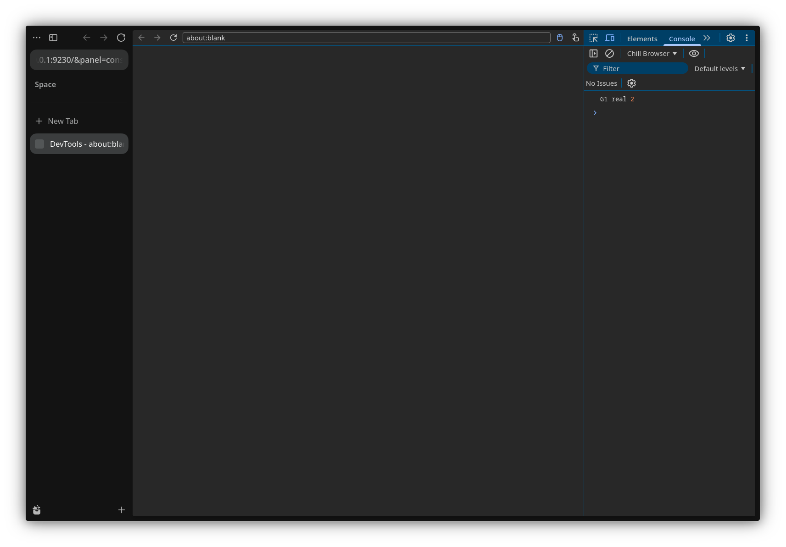

# G1 — Runtime/Console

## Resultado

A bridge passou a avaliar JavaScript real, converter objetos e exceções e
encaminhar eventos de console para o frontend oficial.

O teste de protocolo validou:

- `Runtime.evaluate` com primitivo: `1 + 1` retornou `2`.
- `Runtime.evaluate` com objeto: `({ a: 1, b: 'x' })` retornou `objectId`.
- `Runtime.getProperties`: propriedades `a` e `b` foram retornadas.
- Exceção: `throw new Error('boom')` retornou `exceptionDetails`.
- Console: `console.log('G1 real', 1 + 1)` gerou
  `Runtime.consoleAPICalled` com os argumentos corretos.

O frontend oficial exibiu a mensagem no painel Console:

```text
G1 real 2
```



## Teste reproduzível

Com a bridge rodando em uma porta fixa:

```sh
node scripts/test_chrome_devtools_cdp.mjs 9230
```

Saída esperada (resumo):

```json
{
  "sum": { "type": "number", "value": 2, "description": "2" },
  "objectProperties": ["a", "b"],
  "exceptionText": "Error: boom",
  "consoleEvent": {
    "type": "log",
    "args": [
      { "type": "string", "value": "G1 real" },
      { "type": "number", "value": 2 }
    ]
  }
}
```

## Mudanças

- `src/zen/common/modules/ChromeDevToolsBridge.mjs`
  - `Runtime.evaluate` com objetos e exceções.
  - `Runtime.getProperties` via `ObjectFront.getPrototypeAndProperties`.
  - `Runtime.consoleAPICalled` a partir de `consoleAPICall`.
  - Porta fixa opcional em `chill.devtools.chrome.port`.
  - Remoção do spike `chill.devtools.chrome.spike-evaluate`.
- `src/devtools/server/socket/websocket-server-js.patch`
  - Handshake WebSocket com `Connection`/`Upgrade` case-insensitive para
    aceitar clientes CDP padrão, como o WebSocket do Node.
- `scripts/test_chrome_devtools_cdp.mjs`
  - Cliente CDP de teste para primitivos, objetos, exceções e console.

## Limitações

- O input real do painel Console ainda não foi automatizado; o protocolo
  usado pelo painel é o mesmo validado pelo cliente CDP.
- `Runtime.callFunctionOn`, previews de objetos e `awaitPromise` ainda não
  estão implementados.
- O target continua sendo a aba selecionada no startup.
- Domínios fora de `Runtime`/`Page`/`Log`/`Target` retornam erro explícito.

## Próximo

- Implementar `Runtime.callFunctionOn` e previews.
- Testar digitação real no Console.
- Seguir para G2 (Network).
