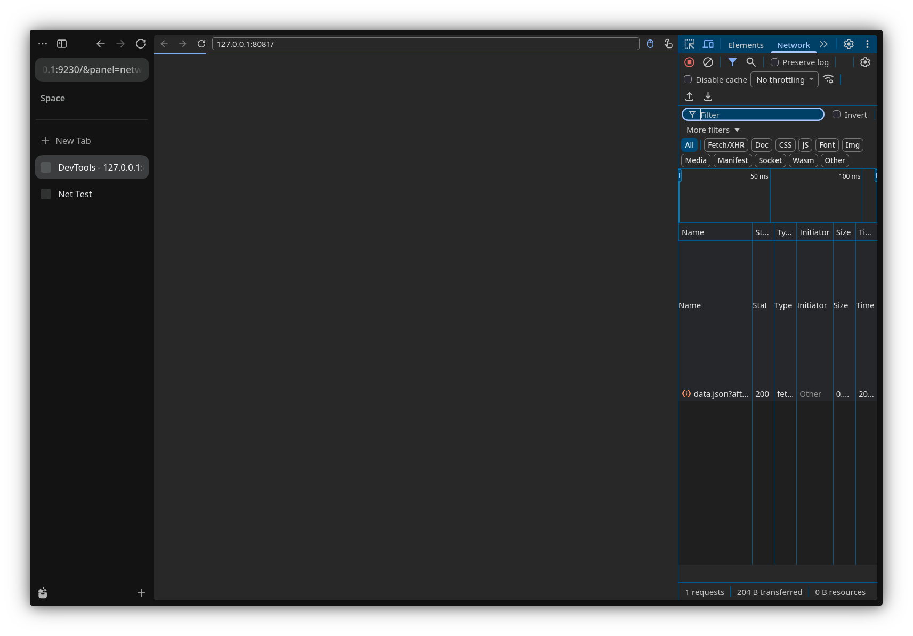

# G2 — Network

## Resultado

O painel Network do frontend oficial passou a receber requisições reais do
target, com método, URL, tipo, status e conclusão.

Teste de protocolo:

```sh
node scripts/test_chrome_devtools_network.mjs 9230
```

Resultado observado:

```json
{
  "requests": [
    {
      "id": 10737418310,
      "method": "GET",
      "url": "http://127.0.0.1:8081/data.json?after=1",
      "type": "Fetch"
    }
  ],
  "responses": [
    {
      "id": 10737418310,
      "url": "http://127.0.0.1:8081/data.json?after=1",
      "status": 200,
      "mimeType": "application/json"
    }
  ],
  "finished": 1
}
```

O painel exibiu a requisição com status `200`:



## Mudanças

- `src/zen/common/modules/ChromeDevToolsBridge.mjs`
  - `Network` adicionado ao `Schema.getDomains`.
  - `Network.enable`/`disable` usando `ResourceCommand` e `NETWORK_EVENT`.
  - `Network.requestWillBeSent` a partir de `resource.requestHeaders`,
    `method`, `url` e `isNavigationRequest`.
  - `Network.responseReceived` a partir de `status`, `statusText`,
    `responseHeaders`, `mimeType`, `remoteAddress`, `remotePort` e
    `eventTimings`.
  - `Network.loadingFinished` e `Network.loadingFailed`.
  - Navegação real em `Page.navigate` via
    `commands.targetCommand.navigateTo()`.
  - Atualização de `Target.targetInfoChanged`/`Page.frameNavigated` quando uma
    navegação é observada.
  - Pref `chill.devtools.chrome.panel` para abrir o frontend em `console` ou
    `network`.
- `scripts/test_chrome_devtools_network.mjs`
  - Cliente CDP de teste para request, response e loadingFinished.

## Limitações

- `Network.getResponseBody` ainda não existe; clicar em uma requisição para
  ver o corpo retorna erro.
- `Network.setBlockedURLs`, cache disabling e throttling ainda são no-op/erro.
- O corpo e o preview de resposta não são capturados.
- O tamanho exibido pode chegar antes da atualização de `transferredSize`.
- Ainda não há teste automatizado do painel visual; o protocolo e o screenshot
  foram validados.

## Próximo

- G3 — DOM/Elements.
